<a href="https://github.com/mcarvin8"><picture><source media="(prefers-color-scheme: dark)" srcset="assets/hero-dark.svg"></picture></a>

<a href="https://github.com/mcarvin8"><picture><source media="(prefers-color-scheme: dark)" srcset="assets/badge-gh-dark.svg"></picture></a>
<a href="https://www.npmjs.com/~mcarvin"><picture><source media="(prefers-color-scheme: dark)" srcset="assets/badge-npm-dark.svg"></picture></a>
<a href="https://crates.io/users/mcarvin8"><picture><source media="(prefers-color-scheme: dark)" srcset="assets/badge-crates-dark.svg"></picture></a>
 
<a href="https://pypi.org/user/mcarvin8/"><picture><source media="(prefers-color-scheme: dark)" srcset="assets/badge-pypi-dark.svg"></picture></a>
<a href="https://hub.docker.com/u/mcarvin8"><picture><source media="(prefers-color-scheme: dark)" srcset="assets/badge-docker-dark.svg"></picture></a>
<a href="https://github.com/mcarvin8/mcarvin8/issues" title="Get in touch: found a bug or have an idea for one of my projects? Open an issue on that repo. Contributions are welcome from forks. Want to collaborate on something new or ask something in general? Open an issue here."><picture><source media="(prefers-color-scheme: dark)" srcset="assets/badge-hi-dark.svg"></picture></a>

<picture><source media="(prefers-color-scheme: dark)" srcset="assets/label-projects-dark.svg"></picture>

<a href="https://github.com/mcarvin8/sf-decomposer"><picture><source media="(prefers-color-scheme: dark)" srcset="assets/project-sf-decomposer-dark.svg"></picture></a>
<a href="https://github.com/mcarvin8/apex-code-coverage-transformer"><picture><source media="(prefers-color-scheme: dark)" srcset="assets/project-apex-code-coverage-transformer-dark.svg"></picture></a>
<a href="https://github.com/mcarvin8/smart-diff"><picture><source media="(prefers-color-scheme: dark)" srcset="assets/project-smart-diff-dark.svg">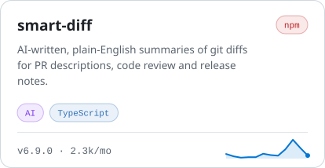</picture></a>
<a href="https://github.com/mcarvin8/sf-flow-coverage"><picture><source media="(prefers-color-scheme: dark)" srcset="assets/project-sf-flow-coverage-dark.svg"></picture></a>

<picture><source media="(prefers-color-scheme: dark)" srcset="assets/label-more-dark.svg"></picture>

<a href="https://github.com/mcarvin8/config-disassembler"><picture><source media="(prefers-color-scheme: dark)" srcset="assets/tile-config-disassembler-dark.svg">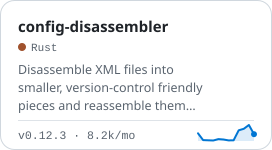</picture></a>
<a href="https://github.com/mcarvin8/sf-package-combiner"><picture><source media="(prefers-color-scheme: dark)" srcset="assets/tile-sf-package-combiner-dark.svg">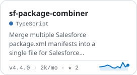</picture></a>
<a href="https://github.com/mcarvin8/apex-tests-git-delta"><picture><source media="(prefers-color-scheme: dark)" srcset="assets/tile-apex-tests-git-delta-dark.svg">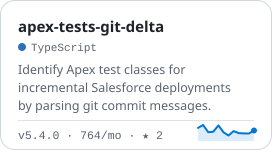</picture></a>
<a href="https://github.com/mcarvin8/sf-git-ai-meta-insights"><picture><source media="(prefers-color-scheme: dark)" srcset="assets/tile-sf-git-ai-meta-insights-dark.svg">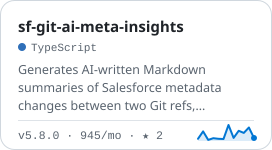</picture></a>
<a href="https://github.com/mcarvin8/sf-package-list"><picture><source media="(prefers-color-scheme: dark)" srcset="assets/tile-sf-package-list-dark.svg">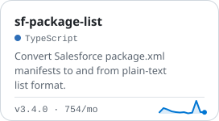</picture></a>
<a href="https://github.com/mcarvin8/sf-cat"><picture><source media="(prefers-color-scheme: dark)" srcset="assets/tile-sf-cat-dark.svg">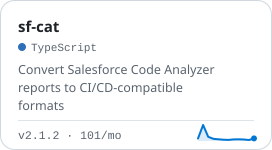</picture></a>
<a href="https://github.com/mcarvin8/sfmon"><picture><source media="(prefers-color-scheme: dark)" srcset="assets/tile-sfmon-dark.svg">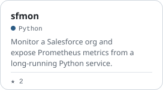</picture></a>
<a href="https://github.com/mcarvin8/statuspage-prometheus-exporter"><picture><source media="(prefers-color-scheme: dark)" srcset="assets/tile-statuspage-prometheus-exporter-dark.svg">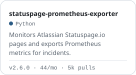</picture></a>
<a href="https://github.com/mcarvin8/sf-gitlab-cicd-template"><picture><source media="(prefers-color-scheme: dark)" srcset="assets/tile-sf-gitlab-cicd-template-dark.svg">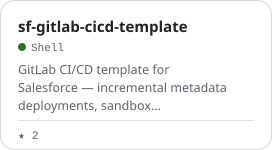</picture></a>

<picture><source media="(prefers-color-scheme: dark)" srcset="assets/toolbox-dark.svg"></picture>

<picture><source media="(prefers-color-scheme: dark)" srcset="assets/label-oss-dark.svg"></picture>

<a href="https://github.com/forcedotcom/source-deploy-retrieve"><picture><source media="(prefers-color-scheme: dark)" srcset="assets/oss-forcedotcom-source-deploy-retrieve-dark.svg">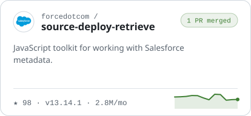</picture></a>
<a href="https://github.com/salesforcecli/plugin-deploy-retrieve"><picture><source media="(prefers-color-scheme: dark)" srcset="assets/oss-salesforcecli-plugin-deploy-retrieve-dark.svg">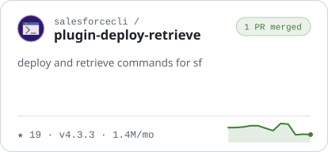</picture></a>
<a href="https://github.com/scolladon/sfdx-git-delta"><picture><source media="(prefers-color-scheme: dark)" srcset="assets/oss-scolladon-sfdx-git-delta-dark.svg">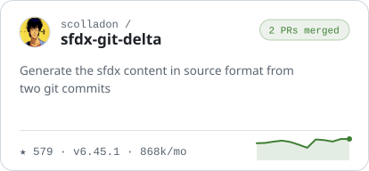</picture></a>
<a href="https://github.com/scolladon/sf-git-merge-driver"><picture><source media="(prefers-color-scheme: dark)" srcset="assets/oss-scolladon-sf-git-merge-driver-dark.svg">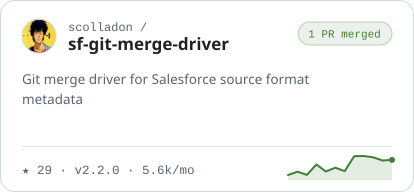</picture></a>
<a href="https://github.com/hardisgroupcom/sfdx-hardis"><picture><source media="(prefers-color-scheme: dark)" srcset="assets/oss-hardisgroupcom-sfdx-hardis-dark.svg">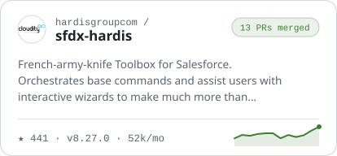</picture></a>
<a href="https://github.com/wisefoxme/apex-test-list"><picture><source media="(prefers-color-scheme: dark)" srcset="assets/oss-wisefoxme-apex-test-list-dark.svg">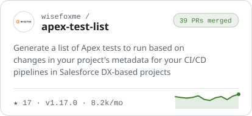</picture></a>

<picture><source media="(prefers-color-scheme: dark)" srcset="assets/stats-dark.svg"></picture>

Cards drawn by <a href="https://github.com/mcarvin8/mcarvin8/tree/main/src">src/</a> in this repo · numbers redrawn every night by a GitHub Action

