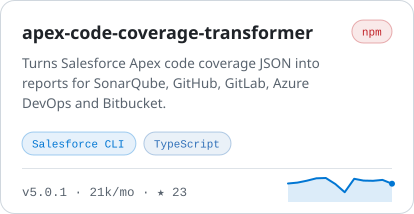

<a href="https://github.com/mcarvin8"><picture><source media="(prefers-color-scheme: dark)" srcset="assets/hero-dark.svg"></picture></a>

<a href="https://github.com/mcarvin8"><picture><source media="(prefers-color-scheme: dark)" srcset="assets/badge-gh-dark.svg"></picture></a>
<a href="https://www.npmjs.com/~mcarvin"><picture><source media="(prefers-color-scheme: dark)" srcset="assets/badge-npm-dark.svg"></picture></a>
<a href="https://crates.io/users/mcarvin8"><picture><source media="(prefers-color-scheme: dark)" srcset="assets/badge-crates-dark.svg"></picture></a>
<a href="https://github.com/mcarvin8/mcarvin8/issues" title="Get in touch: found a bug or have an idea for one of my projects? Open an issue on that repo. Contributions are welcome from forks. Want to collaborate on something new or ask something in general? Open an issue here."><picture><source media="(prefers-color-scheme: dark)" srcset="assets/badge-hi-dark.svg"></picture></a>

<picture><source media="(prefers-color-scheme: dark)" srcset="assets/label-projects-dark.svg"></picture>

<a href="https://github.com/mcarvin8/sf-decomposer"><picture><source media="(prefers-color-scheme: dark)" srcset="assets/project-sf-decomposer-dark.svg"></picture></a>
<a href="https://github.com/mcarvin8/apex-code-coverage-transformer"><picture><source media="(prefers-color-scheme: dark)" srcset="assets/project-apex-code-coverage-transformer-dark.svg"></picture></a>
<a href="https://github.com/mcarvin8/smart-diff"><picture><source media="(prefers-color-scheme: dark)" srcset="assets/project-smart-diff-dark.svg"></picture></a>
<a href="https://github.com/mcarvin8/sf-flow-coverage"><picture><source media="(prefers-color-scheme: dark)" srcset="assets/project-sf-flow-coverage-dark.svg"></picture></a>

<b>More projects</b>

- [**config-disassembler**](https://github.com/mcarvin8/config-disassembler): Rust crate (with Node bindings via napi-rs) that splits config files into small, VCS-friendly pieces and reassembles them. The engine behind sf-decomposer.
- [**sfmon**](https://github.com/mcarvin8/sfmon): monitor a Salesforce org and expose Prometheus metrics.
- [**statuspage-prometheus-exporter**](https://github.com/mcarvin8/statuspage-prometheus-exporter): export Atlassian Statuspage incidents as Prometheus metrics.
- [**sf-package-combiner**](https://github.com/mcarvin8/sf-package-combiner): merge multiple Salesforce `package.xml` manifests into one for Salesforce CLI deployments.
- [**sf-package-list**](https://github.com/mcarvin8/sf-package-list): convert `package.xml` manifests to and from plain-text lists.
- [**apex-tests-git-delta**](https://github.com/mcarvin8/apex-tests-git-delta): pick the Apex test classes to run in incremental deployments by parsing git commit messages.
- [**sf-gitlab-cicd-template**](https://github.com/mcarvin8/sf-gitlab-cicd-template): GitLab CI/CD template for Salesforce: incremental metadata deployments, sandbox management, and static analysis.

<picture><source media="(prefers-color-scheme: dark)" srcset="assets/toolbox-dark.svg"></picture>

<picture><source media="(prefers-color-scheme: dark)" srcset="assets/label-oss-dark.svg"></picture>

<a href="https://github.com/scolladon/sfdx-git-delta"><picture><source media="(prefers-color-scheme: dark)" srcset="assets/oss-scolladon-sfdx-git-delta-dark.svg"></picture></a>
<a href="https://github.com/scolladon/sf-git-merge-driver"><picture><source media="(prefers-color-scheme: dark)" srcset="assets/oss-scolladon-sf-git-merge-driver-dark.svg"></picture></a>
<a href="https://github.com/hardisgroupcom/sfdx-hardis"><picture><source media="(prefers-color-scheme: dark)" srcset="assets/oss-hardisgroupcom-sfdx-hardis-dark.svg"></picture></a>
<a href="https://github.com/wisefoxme/apex-test-list"><picture><source media="(prefers-color-scheme: dark)" srcset="assets/oss-wisefoxme-apex-test-list-dark.svg"></picture></a>

<picture><source media="(prefers-color-scheme: dark)" srcset="assets/stats-dark.svg"></picture>

Cards drawn by <a href="https://github.com/mcarvin8/mcarvin8/tree/main/src">src/</a> in this repo · numbers redrawn every night by a GitHub Action

