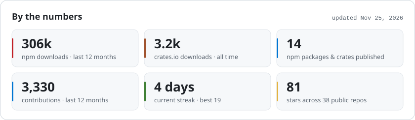
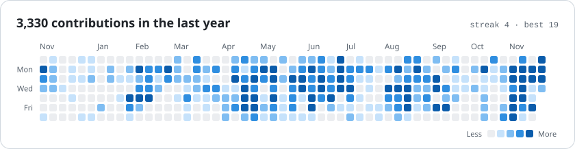
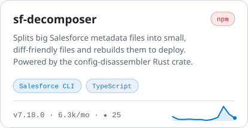
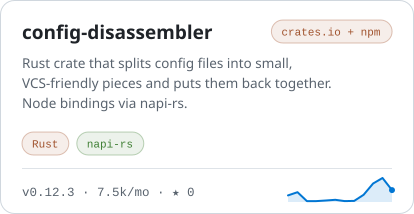
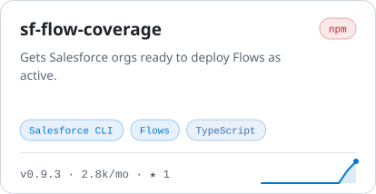

<a href="https://github.com/mcarvin8"><picture><source media="(prefers-color-scheme: dark)" srcset="assets/hero-dark.svg"></picture></a>

<a href="https://github.com/mcarvin8"><picture><source media="(prefers-color-scheme: dark)" srcset="assets/badge-gh-dark.svg"></picture></a>
<a href="https://www.npmjs.com/~mcarvin"><picture><source media="(prefers-color-scheme: dark)" srcset="assets/badge-npm-dark.svg"></picture></a>
<a href="https://crates.io/users/mcarvin8"><picture><source media="(prefers-color-scheme: dark)" srcset="assets/badge-crates-dark.svg"></picture></a>
<a href="https://github.com/mcarvin8/mcarvin8/issues"><picture><source media="(prefers-color-scheme: dark)" srcset="assets/badge-hi-dark.svg"></picture></a>

<picture><source media="(prefers-color-scheme: dark)" srcset="assets/stats-dark.svg"></picture>

<picture><source media="(prefers-color-scheme: dark)" srcset="assets/heatmap-dark.svg"></picture>

<picture><source media="(prefers-color-scheme: dark)" srcset="assets/label-projects-dark.svg"></picture>

<a href="https://github.com/mcarvin8/sf-decomposer"><picture><source media="(prefers-color-scheme: dark)" srcset="assets/project-sf-decomposer-dark.svg"></picture></a>
<a href="https://github.com/mcarvin8/apex-code-coverage-transformer"><picture><source media="(prefers-color-scheme: dark)" srcset="assets/project-apex-code-coverage-transformer-dark.svg"></picture></a>
<a href="https://github.com/mcarvin8/smart-diff"><picture><source media="(prefers-color-scheme: dark)" srcset="assets/project-smart-diff-dark.svg"></picture></a>
<a href="https://github.com/mcarvin8/config-disassembler"><picture><source media="(prefers-color-scheme: dark)" srcset="assets/project-config-disassembler-dark.svg"></picture></a>
<a href="https://github.com/mcarvin8/sf-flow-coverage"><picture><source media="(prefers-color-scheme: dark)" srcset="assets/project-sf-flow-coverage-dark.svg"></picture></a>

<b>More projects</b>

- [**sfmon**](https://github.com/mcarvin8/sfmon): monitor a Salesforce org and expose Prometheus metrics.
- [**statuspage-prometheus-exporter**](https://github.com/mcarvin8/statuspage-prometheus-exporter): export Atlassian Statuspage incidents as Prometheus metrics.
- [**sf-package-combiner**](https://github.com/mcarvin8/sf-package-combiner): merge multiple Salesforce `package.xml` manifests into one for Salesforce CLI deployments.
- [**sf-package-list**](https://github.com/mcarvin8/sf-package-list): convert `package.xml` manifests to and from plain-text lists.
- [**apex-tests-git-delta**](https://github.com/mcarvin8/apex-tests-git-delta): pick the Apex test classes to run in incremental deployments by parsing git commit messages.
- [**sf-gitlab-cicd-template**](https://github.com/mcarvin8/sf-gitlab-cicd-template): GitLab CI/CD template for Salesforce: incremental metadata deployments, sandbox management, and static analysis.

<picture><source media="(prefers-color-scheme: dark)" srcset="assets/toolbox-dark.svg"></picture>

<picture><source media="(prefers-color-scheme: dark)" srcset="assets/label-oss-dark.svg"></picture>

I've contributed to these projects from the open-source Salesforce community:

- [**sfdx-git-delta**](https://github.com/scolladon/sfdx-git-delta) by [@scolladon](https://github.com/scolladon): generates Salesforce incremental deployment content from Git changes.
- [**sf-git-merge-driver**](https://github.com/scolladon/sf-git-merge-driver) by [@scolladon](https://github.com/scolladon): assists with Git merge handling for Salesforce metadata.
- [**sfdx-hardis**](https://github.com/hardisgroupcom/sfdx-hardis) by [@hardisgroupcom](https://github.com/hardisgroupcom): Salesforce DevOps and Monitoring platform.
- [**apex-test-list**](https://github.com/wisefoxme/apex-test-list) by [@wisefoxme](https://github.com/wisefoxme): identifies Apex tests to run based on test annotations.

<picture><source media="(prefers-color-scheme: dark)" srcset="assets/label-contact-dark.svg"></picture>

Found a bug or have an idea for one of my projects? Open an issue on that repo. Contributions are welcome from forks.

Want to collaborate on something new or ask something in general? [Open an issue here](https://github.com/mcarvin8/mcarvin8/issues).

Cards drawn by <a href="https://github.com/mcarvin8/mcarvin8/tree/main/src">src/</a> in this repo · numbers redrawn every night by a GitHub Action

